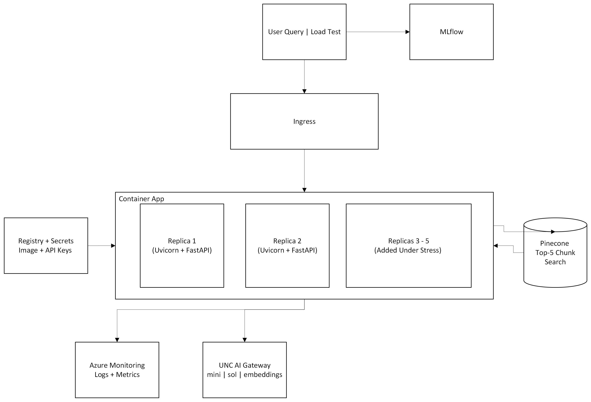

# Warhammer 40K Rules Assistant: Cloud Deployment

DATA 790 Cloud Deployment Project · Joshua Farmer

My Milestone 2 security-hardened RAG assistant ([Student_Warhammer_Milestone2](https://github.com/Jfarm17/Student_Warhammer_Milestone2)), served with FastAPI and deployed as a container to **Azure Container Apps** with HTTP autoscaling. It is monitored with **Azure Monitor** and **MLflow**, and also runs on **Kubernetes**.

**Live API:** https://w40k-rag.victorioushill-f2ce5271.eastus.azurecontainerapps.io/docs



## Deliverables

| | |
|---|---|
| Deployment report | [Farmer_Joshua_Cloud_Deployment_Report.pdf](Farmer_Joshua_Cloud_Deployment_Report.pdf) (full version: [REPORT.md](REPORT.md)) |
| Architecture diagram | [architecture.png](architecture.png) |
| Step-by-step guide | [DEPLOY_GUIDE.md](DEPLOY_GUIDE.md) |
| Commands used | [commands_run.txt](commands_run.txt) |

## Files

| Path | What it is |
|---|---|
| `app.py` | FastAPI app: `POST /ask`, `GET /health`, `GET /metrics` |
| `Dockerfile`, `.dockerignore`, `requirements.txt` | container image |
| `k8s/` | Kubernetes Deployment, Service (LoadBalancer) and HPA |
| `load_test.py` | 100 concurrent `/ask` requests, logged to MLflow |
| `screenshots/` | Azure Monitor, kubectl and MLflow evidence |

## Run

```bash
docker build -t w40k-rag .
docker run --rm -p 8000:8000 --env-file ../.env w40k-rag      # http://localhost:8000/docs
kubectl create secret generic w40k-secrets --from-env-file=../.env
kubectl apply -f k8s/                                          # http://localhost/docs
```

Needs `UNC_AI_API_KEY` and `UNC_PINECONE_API_KEY`. Keys are never committed: they live in `.env` locally, in Container App secrets on Azure, and in a Kubernetes Secret on the cluster.
