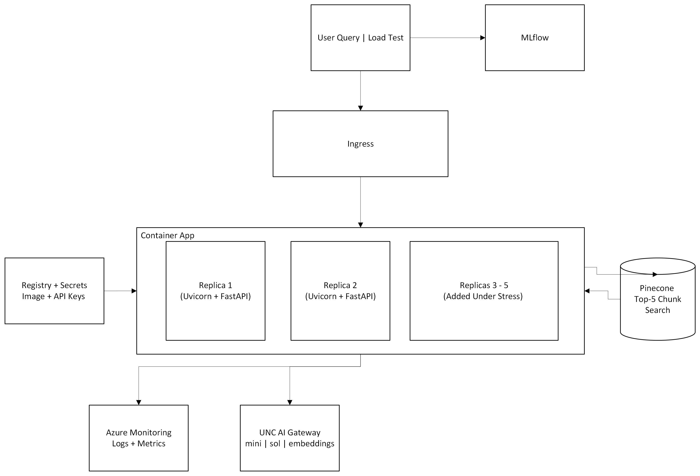
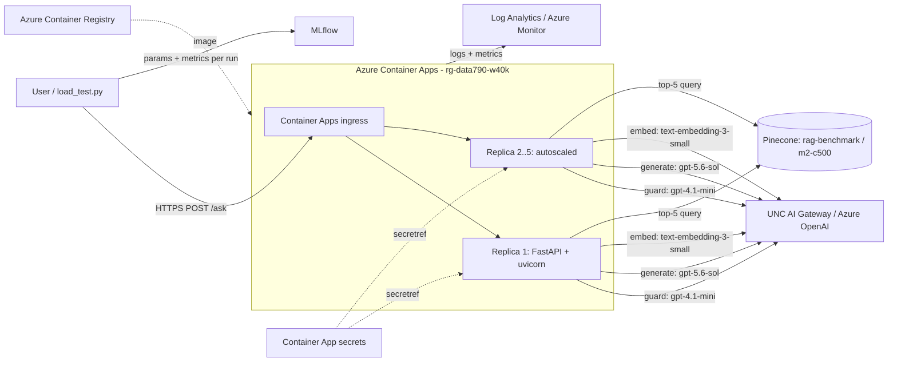
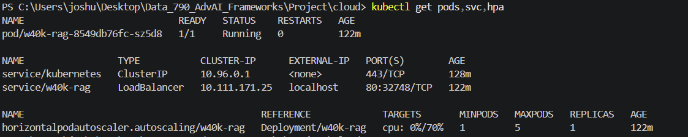
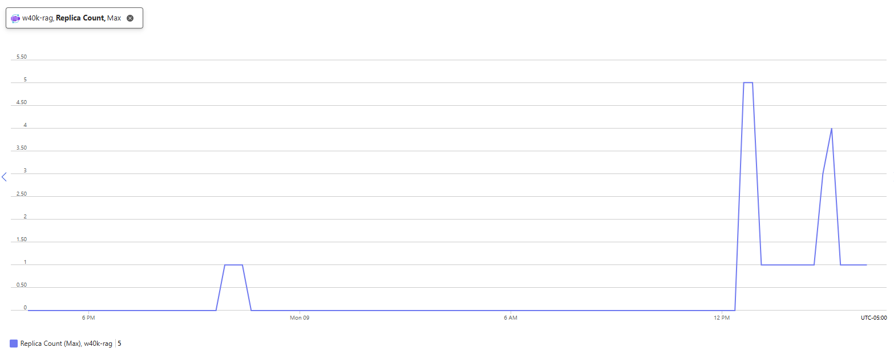
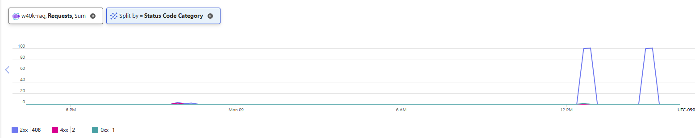
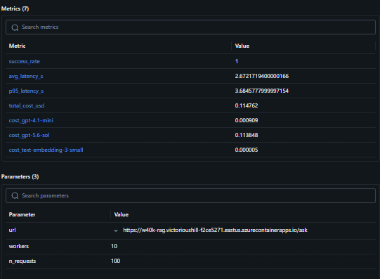
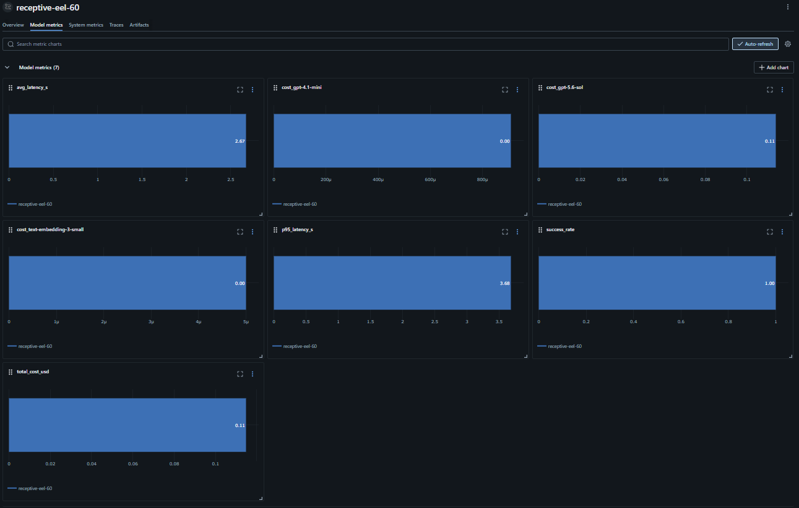

# Cloud Deployment Report: Warhammer 40K Rules Assistant

**DATA 790 · Joshua Farmer**

Live API: https://w40k-rag.victorioushill-f2ce5271.eastus.azurecontainerapps.io/docs

---

## 1. Overview

I took my Milestone 2 security-hardened RAG assistant (Warhammer 40,000 10th edition rules, datasheets and lore) and turned it from a notebook into a containerized web API. It is deployed on **Azure Container Apps** with HTTP-based autoscaling, monitored with **Azure Monitor / Log Analytics** and **MLflow**, and also runs on **Kubernetes** from the same image using a Deployment, Service and HPA.

| Requirement | Where |
|---|---|
| Containerized AI application (Docker) | `Dockerfile`, `.dockerignore`, `requirements.txt`, `app.py` |
| Kubernetes deployment configuration | `k8s/deployment.yaml`, `k8s/service.yaml`, `k8s/hpa.yaml` (Section 4) |
| Cloud platform deployment | Azure Container Apps (Section 3) |
| Monitoring and observability (MLflow) | Azure Monitor + MLflow load-test tracking + app `/metrics` (Section 6) |
| Auto-scaling configuration | Container Apps HTTP scale rule + Kubernetes HPA (Section 5) |
| Cost analysis and optimization | Section 7 |

---

## 2. Architecture

**What each part does:**

- **Ingress:** the public HTTPS front door. It receives every request and spreads it across the running replicas.
- **Replicas:** identical running copies of the Docker container. Each one is the whole app (FastAPI, the four security layers, the RAG pipeline, its own cost tracker). They are **stateless**: they share no memory, so everything shared lives outside them (keys in secrets, knowledge in Pinecone, models behind the gateway). That is what makes it safe for Azure to add or remove copies at any time.
  - Replica 1 is always on (`min-replicas 1`) and handles normal traffic.
  - When requests in flight exceed 5 per replica, Azure adds Replica 2, then up to Replicas 3–5 if the load keeps growing.
  - After 5 quiet minutes, the extra copies are removed.
  - This keeps requests from queuing and timing out, keeps the service up if one replica restarts, and only pays for extra copies during a rush.
- **UNC AI Gateway:** Azure API Management in front of Azure OpenAI. The models do not run in the container; each replica calls the gateway over HTTPS. The gateway checks the API key, enforces UNC's rate limits and quotas, runs Azure's content filter on prompts and responses, and forwards the call to the right model:
  - text-embedding-3-small: question → vector
  - gpt-4.1-mini: one-word SAFE/UNSAFE guard
  - gpt-5.6-sol: writes the answer
- **Pinecone:** the vector database holding the corpus. In Milestone 2, every chunk of the rules, datasheets and lore was embedded and stored in `rag-benchmark / m2-c500`. The server only searches it: given the question's vector, Pinecone returns the 5 closest chunks. This works because the question is embedded with the same model as the chunks.
- **In short:** the gateway supplies the intelligence, Pinecone supplies the knowledge, and the replica orchestrates the steps, adds the security, and tracks the cost.

**Limit of scaling:** every replica shares the same gateway and the same rate limit. Adding replicas stops requests from piling up inside the app, but it cannot make the LLM respond faster. That is exactly what the 20-concurrent load test showed (Section 6).

**Request flow (`POST /ask`):**

1. PII redaction on the question
2. Layer 1: pattern check (injection phrases, Lab 9 regexes)
3. Layer 2: LLM guard (gpt-4.1-mini, SAFE/UNSAFE)
4. Embed the question and retrieve the top 5 chunks from Pinecone
5. Layer 3: sanitize the chunks (strip hidden comments, fake system tags, instruction-like sentences)
6. Generate the answer with gpt-5.6-sol, with context in the user message and never the system prompt
7. Layer 4: output guard (canary/prompt-leak check, chunk-id stripping, link allow-list, PII redaction)

If the gateway's content filter hard-blocks a call, the API returns a `blocked_reason` instead of erroring.

**Endpoints:**
- `POST /ask` answers a question.
- `GET /health` is the liveness/readiness check.
- `GET /metrics` returns calls, total cost, cost by model and the number of flagged calls.

---

## 3. Containerization and Azure deployment

1. **Refactor:** I moved the Demo-RAG pipeline and the four security layers from the notebook into `app.py` and added the FastAPI endpoints. Evaluation, Self-RAG and ingestion stayed in the notebook, since the index is already populated and the server only connects to it.
2. **Image:** `python:3.12-slim`, dependencies pinned to the versions tested in my venv, served by uvicorn on `0.0.0.0:8000`. `.dockerignore` keeps `.env`, notebooks and caches out of the image.
3. **Local test:** `docker build` then `docker run --env-file`, and checked `/docs`.
4. **Deploy:** `az containerapp up --source .`. One command created the resource group, the Container Apps environment, the Log Analytics workspace and the Azure Container Registry, built the image in the cloud and deployed it with external ingress on port 8000.
5. **Secrets:** API keys are stored as Container App secrets and injected as `secretref:` environment variables. No keys exist in the image or the code. The first revision failed health checks because the secrets were set but not yet mapped to env vars; running `az containerapp update --set-env-vars ...` created a healthy revision.

---

## 4. Kubernetes

The same image runs on Kubernetes (Docker Desktop, kubeadm, v1.36.1) with three manifests in `k8s/`:

- **deployment.yaml:**
  - 1 replica of the `w40k-rag` image (`imagePullPolicy: Never` for the local image)
  - Keys come from a Kubernetes Secret via `envFrom`
  - A readiness probe on `/health`
  - CPU/memory requests (250m / 512Mi) and limits (500m / 1Gi)
- **service.yaml:** a LoadBalancer Service, port 80 → 8000 (localhost on Docker Desktop).
- **hpa.yaml:** autoscaling/v2 HPA, 1–5 pods, 70% average CPU. metrics-server was installed (patched with `--kubelet-insecure-tls` for Docker Desktop's self-signed kubelet cert) so the HPA has data.

Result after 2 hours of uptime:
- Pod `1/1 Running` with 0 restarts
- LoadBalancer service on `localhost:80`
- HPA reading `cpu: 0%/70%` (1 of max 5 replicas)
- `kubectl top` showing 3m CPU / 167Mi memory at idle

**Mapping to Container Apps** (Container Apps is managed Kubernetes and uses KEDA for scaling):

| Kubernetes | Azure Container Apps |
|---|---|
| Deployment | Container App revision |
| Pod | Replica |
| Service (LoadBalancer) | External ingress / FQDN |
| Secret + `envFrom` | Secrets + `secretref:` |
| HPA (CPU) + metrics-server | KEDA HTTP scale rule |
| `kubectl logs` / `kubectl top` | Log stream / Metrics |

To move these manifests to AKS/EKS/GKE, replace the image with the ACR path and remove `imagePullPolicy: Never`.

---

## 5. Autoscaling

**Azure Container Apps** (HTTP scale rule):

| Setting | Value |
|---|---|
| Min / max replicas | 1 / 5 |
| Rule | HTTP, 5 concurrent requests per replica |
| Polling interval | 30 s |
| Cooldown before scale-down | 300 s |

**Kubernetes:** HPA on CPU, 1–5 pods, 70% target.

**Why the two scale on different signals:** this app is I/O-bound. Almost all of a request's ~2–4 s is spent waiting on the LLM gateway and Pinecone, not on CPU. The pod used 3m CPU (about 1% of its request) at idle, so a CPU-based HPA would barely react even under heavy load. Request concurrency is the right signal for an LLM API, which is why the Azure deployment uses the HTTP rule (KEDA). On Kubernetes, the equivalent production setup would be KEDA's HTTP add-on or a custom requests-per-second metric instead of CPU.

The Replica Count chart (Max, last 24 h) shows both load tests.
- **First test (~12:30 PM):** the app scaled from 1 to the 5-replica cap.
- **MLflow run (~3 PM):** it scaled to 4.
- **Afterwards:** both times it dropped back to the 1-replica minimum once the 300 s cooldown passed.
- **Before the tests:** the app sat at 0 until the minimum was raised to 1 for the scale rule.

---

## 6. Monitoring and observability

Three layers, each answering a different question:

| Layer | Tool | Answers |
|---|---|---|
| Infrastructure | Azure Monitor Metrics: Replica Count, Requests by status code, Response Time | Is it up, how busy, did it scale? |
| Logs | Log stream + Log Analytics (`ContainerAppConsoleLogs_CL`) | What happened on each replica? |
| App / experiment | MLflow (each load-test run) + `GET /metrics` | How fast, how reliable, how much did the LLM calls cost, by model? |

**MLflow:** `load_test.py` logs each run to the experiment `w40k-cloud-load-test`:
- Params: URL, workers, number of requests.
- Metrics: success rate, average and p95 latency, total cost, and cost per model (from `/metrics`).

**App `/metrics`:** the cost tracker from Milestone 2 now records the **model** and any **content-filter category** Azure flagged on a successful response (from `model_extra["content_filter_results"]`). Hard blocks are caught as `BadRequestError` and returned as a `blocked_reason`.

Requests (Sum, split by Status Code Category, last 24 h):
- **Two spikes of about 100 requests** line up exactly with the two replica peaks.
- **Totals: 408 × 2xx, 2 × 4xx, 1 × 0xx.**
  - The 2xx total includes both 100-request load tests, the first timed-out attempt (the server still finished those requests after the client gave up), and manual tests.
  - The 4xx responses are client errors from manual testing.
  - The 0xx is a connection closed before a response was sent, consistent with the client-side timeouts in the first attempt.
- **No 5xx:** the app itself never failed under load.

### Load test results

`load_test.py`: 100 × `POST /ask`, 10 concurrent, same question each time.

| Metric | Result |
|---|---|
| Success rate | 100% (100 × HTTP 200) |
| Average latency | 2.67 s |
| p95 latency | 3.68 s |
| Peak replicas | 5 (first test), 4 (MLflow run); back to 1 after cooldown |
| Cost per question | ≈ $0.0034 |

**What went wrong first:** the first attempt at 20 concurrent requests failed with read timeouts after 120 s. The container wasn't the bottleneck. The UNC gateway was throttling the slow reasoning-model calls, and the OpenAI SDK's automatic retries stretched some requests past the client timeout. Lowering to 10 concurrent and catching errors per request fixed it. Scaling the app does not raise the upstream LLM quota, because all replicas share it.

**Per-replica limitation:** the cost tracker lives in memory, so each replica counts only its own calls. After scale-out, `/metrics` reflects only the replica that answered. The MLflow run `receptive-eel-60` (100 requests) reported $0.1148, against the ≈ $0.34 that 100 requests cost on a single replica. That means the replica that answered `/metrics` served only about a third of the load; the rest went to other replicas. Azure Monitor is the source of truth for totals. A production version would send these records to Application Insights or a database.

---

## 7. Cost analysis and optimization

### Measured LLM cost (100 questions, single replica)

| Model | Role | Cost | Share |
|---|---|---|---|
| gpt-5.6-sol | answer generation | $0.33286 | 99.1% |
| gpt-4.1-mini | LLM guard | $0.00284 | 0.8% |
| text-embedding-3-small | query embedding | $0.000016 | <0.01% |
| **Total** | | **$0.3357** | **≈ $0.0034 / question** |

### Projections (LLM cost only)

| Volume | Per day | Per month |
|---|---|---|
| 100 questions/day | $0.34 | ≈ $10 |
| 1,000 questions/day | $3.40 | ≈ $100 |
| 10,000 questions/day | $34 | ≈ $1,000 |

### Infrastructure cost drivers

- **Container Apps (consumption):** billed per vCPU-second and GiB-second while replicas run. With `min-replicas 1`, one replica is always on. With `min-replicas 0`, there is no idle compute cost, but the first request after a quiet period has a cold start.
- **Azure Container Registry (Basic):** a small fixed monthly fee for storing the image.
- **Log Analytics:** billed per GB of logs ingested. Low for this app, but it grows with traffic and log verbosity.
- **Pinecone:** existing index, no extra cost for this deployment.
- **AKS (alternative):** always-on node VMs, even at zero traffic. For one small service with bursty traffic, Container Apps is cheaper and simpler. AKS makes sense with many services or when a cluster already exists.

### Optimizations

| Optimization | Status | Effect |
|---|---|---|
| Model tiering: cheap model for guard steps, advanced model only for the answer | **Done** | Guard runs at gpt-4.1-mini prices (~10× cheaper per token than sol). Small saving per call because the guard prompt is short, but it applies to every request, including blocked ones. |
| Block before retrieval and generation | **Done** | Attacks and empty or too-long queries stop at the free regex layer or the $0.00003 guard, never reaching the expensive generate step. |
| Scale to zero after grading (`--min-replicas 0`) | Planned | Removes idle compute cost. |
| Cheaper generation model for simple questions (route by difficulty) | Proposed | Generation is 99% of the cost. Running it on gpt-4.1-mini would cut cost per question by roughly 85–90%, with a quality trade-off that must be checked against the gold set. |
| Cache answers to repeated questions | Proposed | Common rules questions repeat. A cache hit costs $0 and returns in milliseconds. |
| Cap generation tokens / shorter context (k=5 → 3) | Proposed | Fewer input and reasoning tokens on the most expensive call. |
| Prefer scale-out on concurrency, not CPU | **Done** (Azure) | Avoids over-provisioning CPU for an I/O-bound app. |

**Key takeaway:** the cost and the latency of this system are both dominated by one call, answer generation on the reasoning model. Infrastructure and scaling choices matter far less than which model answers the question.

---

## 8. Lessons learned

- Run `az` from the project folder, not `system32`. `az containerapp up --source .` builds whatever folder you are in.
- Setting a secret isn't enough. It must also be mapped to an env var (`secretref:`), and that mapping creates a new revision.
- `0.0.0.0` is for the server to listen on; browse to `localhost`.
- Docker Desktop Kubernetes: use kubeadm, not kind, to reuse local images. The HPA needs metrics-server.
- Load-test results depend on the upstream LLM's rate limits as much as on the app.
- In-memory metrics don't survive scale-out; use the platform's monitoring for totals.

---

## 9. Reproduce

See `DEPLOY_GUIDE.md` for the full step-by-step guide and `commands_run.txt` for the exact commands used.

**Cleanup after grading:** `az containerapp update -n w40k-rag -g rg-data790-w40k --min-replicas 0`, or `az group delete -n rg-data790-w40k`.
